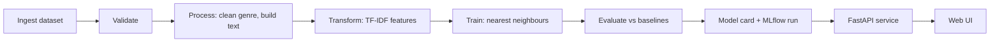

# Book Recommender

Find your next read. Pick a book you loved (or an author, or a genre) and get books that read like it.

**Live demo:** <https://ai-book-recommender-production-95ca.up.railway.app>


[](https://github.com/YOUR-USERNAME/YOUR-REPO/actions/workflows/main.yml)

It is a content-based recommender over about 11,000 books. It reads each book's title, authors and description, and suggests the books whose text is most similar. It does not use accounts, reviews or reading history.

## Contents

- [How it works](#how-it-works)
- [Quickstart](#quickstart)
- [API](#api)
- [Configuration](#configuration)
- [Experiments and results](#experiments-and-results)
- [Testing and CI/CD](#testing-and-cicd)
- [Deployment](#deployment)
- [Project layout](#project-layout)
- [Data and credits](#data-and-credits)
- [Limitations](#limitations)

## How it works



1. **Pipeline** (`main.py`). Six stages download the dataset, check it, clean it, turn each book's text into numbers, train a nearest-neighbour model, and evaluate it. Each stage is also runnable on its own, for example `python -m Book_recommender.pipeline.stage_05_MT`.
2. **Recommendation.** For a chosen book, the model finds its nearest neighbours by cosine similarity. Your filters (minimum rating, genre, language) apply to the *recommendations*, so a result always matches what you asked for. The book itself and duplicate editions are removed.
3. **Service.** A FastAPI app loads the trained artifacts once at start-up and serves both the JSON API and the single-page UI.
4. **Model page.** The site has a Model page that explains the running model and how well it performs, generated from a model card written at the end of every training run.

## Quickstart

You need Python 3.10 or newer.

```bash
git clone https://github.com/YOUR-USERNAME/YOUR-REPO.git
cd YOUR-REPO

python -m venv .venv
source .venv/bin/activate          # Windows: .venv\Scripts\activate
pip install -r requirements-train.txt
pip install -e .

python main.py                     # downloads data, trains, evaluates (a few minutes)
python app.py                      # http://127.0.0.1:8080
```

With Docker, which trains the model during the image build:

```bash
docker build -t book-recommender .
docker run --rm -p 8080:8080 book-recommender
```

Open <http://127.0.0.1:8080> (not `0.0.0.0`).

For development, install `requirements-dev.txt` instead, then run `pytest` and `ruff check .`.

## API

Interactive documentation is at `/docs`. The supported API lives under `/v1`.

| Endpoint | Purpose | Parameters |
|---|---|---|
| `GET /v1/recommend` | Books similar to a title or author | `title`, `author`, `genre`, `min_rating` (0 to 5), `language` (default `eng`), `n` (1 to 20, default 5). At least one of `title`, `author`, `genre` is required. |
| `GET /v1/top` | Top-rated books in a genre | `genre` (required), `min_rating`, `n` |
| `GET /v1/popular` | A fresh random selection of well-rated books | `n` (1 to 30, default 15) |
| `GET /v1/genres` | All genre labels | none |
| `GET /v1/model` | The model card shown on the Model page | none |
| `GET /health` | Liveness: the process is up | none |
| `GET /ready` | Readiness: model and data are loaded | none |

```bash
curl "http://127.0.0.1:8080/v1/recommend?title=Dune&min_rating=4&n=3"
```

```json
{
  "recommendations": [
    {
      "title": "Children of Dune (Dune Chronicles #3)",
      "authors": "Frank Herbert",
      "average_rating": 3.9,
      "genre": "Science Fiction",
      "cover_url": "https://covers.openlibrary.org/b/isbn/9780000000000-M.jpg",
      "isbn13": "9780000000000"
    }
  ],
  "count": 1
}
```

(The values above are illustrative.) Errors use standard status codes: `404` when nothing matches, `422` for invalid input, `429` when the rate limit is exceeded (with a `Retry-After` header), and `503` while the model is still loading. Server errors return a generic message and a request ID, also sent as the `X-Request-ID` header, which you can find in the logs.

## Configuration

Two YAML files drive the pipeline, and developers change behaviour without touching code:

- `config/config.yaml` holds paths and non-tunable settings. Relative paths are resolved against the project root, so commands work from any directory.
- `params.yaml` holds everything you would tune.

```yaml
data_processing:
  feature_fields: [title, authors, description]   # text the model reads

data_transformation:
  method: tfidf            # tfidf | embeddings
  tfidf: { ngram_range: [1, 2], min_df: 2, sublinear_tf: true, stop_words: english }
  embeddings: { model_name: sentence-transformers/all-MiniLM-L6-v2, batch_size: 64 }

model_trainer:
  model_name: knn          # knn | svd_knn
  knn: { n_neighbors: 10, metric: cosine, algorithm: brute }

quality_gate:              # a build fails if the model scores below these
  min_precision_at_k: 0.12
  min_lift_over_random: 3.0
```

Each block is passed straight through to the underlying scikit-learn class, so any argument those classes accept can be added to `params.yaml` with no code change. To add your own model, write a class with `fit` and `kneighbors`, register it in `MODEL_REGISTRY` in `components/model_trainer.py`, and add a block for it in `params.yaml`.

The embeddings option needs `requirements-embeddings.txt` (it installs PyTorch). The default TF-IDF setup does not.

**Environment variables**

| Variable | Default | Purpose |
|---|---|---|
| `PORT` | `8080` | Port the server listens on |
| `HOST` | see `app.py` | Bind address for `python app.py` |
| `CORS_ORIGINS` | empty (CORS off) | Comma-separated origins allowed to call the API from a browser |
| `RATE_LIMIT_PER_MINUTE` | `120` | Requests per client IP per minute for API calls. `0` disables the limit |
| `LOG_TO_FILE` | `1` | Set to `0` to log to stdout only (used in the container) |
| `BOOK_RECOMMENDER_HOME` | auto-detected | Override the project root |
| `FORWARDED_ALLOW_IPS` | `*` in the container | Trust the proxy's forwarded headers so rate limits see real client IPs |

## Experiments and results

Every pipeline run logs its settings and metrics to [MLflow](https://mlflow.org). To compare runs:

```bash
mlflow ui --backend-store-uri sqlite:///mlflow.db
```

### How quality is measured

There is no per-user data, so the test checks something measurable. Take 2,000 random books, ask the model for the 5 most similar, and count how often each suggestion shares the searched book's genre. **The model is never shown genre**, so it has to work it out from the text. The same test runs on two baselines: recommending the globally most popular books, and picking books at random.

| | Genre agreement @5 | Catalogue reached |
|---|---|---|
| **TF-IDF + nearest neighbours (this model)** | **14.9% ± 1.1** | 53% (at most 90% reachable in this test) |
| Random books | 2.9% ± 0.4 | 59% |
| Most popular books | 0.3% | 0.04% |

The model is about 5 times better than chance. The absolute score looks modest because each book has a single genre tag: a good suggestion from a neighbouring genre (Fantasy and Young Adult, say) counts as a miss, and the tags are not perfect. Read the score as a comparison against the baselines, not as a grade out of 100.

### What was tried

| Variant | Genre agreement @5 |
|---|---|
| TF-IDF, 10,000 term cap | 14.4% |
| TF-IDF, no cap, sublinear term weighting (**default**) | 14.9% |
| TF-IDF, unigrams only | 14.9% |
| TF-IDF + dimensionality reduction (SVD, 150 components) | 10.9% |
| Sentence embeddings (MiniLM) + nearest neighbours | 15.4% |

The margin of error is about ±1.1 points. All TF-IDF settings and the embeddings result fall within it, so nothing beats the default on this metric. SVD is clearly worse. The embeddings model needs PyTorch and a much larger image for no measurable gain, so TF-IDF is the default. Spot checks of series books (Dune, Harry Potter) gave near-identical lists for both.

Every run also writes `artifacts/model_evaluation/model_card.json`, which powers the Model page, and CI fails a build whose model drops below the `quality_gate` in `params.yaml`.

## Testing and CI/CD

```bash
pytest          # unit and API tests on a small toy catalogue (no downloads needed)
ruff check .    # lint
```

GitHub Actions (`.github/workflows/main.yml`) runs on every push and pull request:

1. **Test job:** lint and tests with coverage.
2. **Docker job:** builds the image, which trains the model and enforces the quality gate (`scripts/check_quality.py`), then starts the container and smoke-tests `/ready`, `/v1/recommend`, `/v1/popular` and `/v1/model`, then scans the image for known vulnerabilities with Trivy.

A separate workflow (`uptime.yml`) checks the live site every 15 minutes and fails, and so notifies the owner, if it is down.

## Deployment

The app deploys as a single container built from the `Dockerfile`:

- A multi-stage build trains the model in a throwaway stage, so the runtime image holds only the serving dependencies and the few artifact files the API needs. It runs as a non-root user.
- Hosted on [Railway](https://railway.com), deployed from the `main` branch once CI passes (Railway's *Wait for CI* setting), with `/ready` as the health check.
- Any container host works. The container reads `PORT`, logs to stdout, and exposes `/health` and `/ready`.

## Project layout

```text
.
├── app.py                    # FastAPI app: JSON API and UI
├── main.py                   # runs the whole training pipeline
├── params.yaml               # tunable settings
├── config/config.yaml        # paths and fixed settings
├── src/Book_recommender/
│   ├── components/           # the work each stage does, plus the model card
│   ├── config/               # configuration manager: YAML to typed config
│   ├── constant/             # project root and config paths
│   ├── entity/               # config dataclasses
│   ├── pipeline/             # stage_01 to stage_06, and prediction.py
│   └── utils/                # YAML helpers, rate limiter
├── templates/index.html      # single-page UI
├── static/                   # logo and background image
├── scripts/check_quality.py  # release quality gate
├── tests/
├── research/                 # exploration notebooks
├── Dockerfile
├── requirements*.txt         # runtime, training, embeddings and dev sets
└── .github/workflows/        # CI and uptime check
```

## Data and credits

- **Catalogue:** the [`San0160/Books_enriched`](https://huggingface.co/datasets/San0160/Books_enriched) dataset on Hugging Face (declared MIT by its author), pinned to a fixed revision so every build uses identical data. <!-- TODO: name the original source of the base catalogue and its licence here. -->
- **Covers:** loaded in the visitor's browser from [Open Library](https://openlibrary.org) by ISBN. Not every book has one.

## Limitations

- **It does not know you.** There are no accounts or reading history, so the same search always gives the same answer.
- **It compares text, not taste.** Books described in similar words rank as similar.
- **Ratings are filters, not signals.** Minimum rating narrows results and Popular picks use ratings, but similarity itself ignores them.
- **English by default.** Searches return English-language books (`eng`, `en-US`, `en-GB`) unless a `language` is given through the API.
- **The quality metric is a proxy.** Genre agreement against single tags understates real quality. A hand-labelled set of similar books is the planned next step.

## License

See [LICENSE](LICENSE).